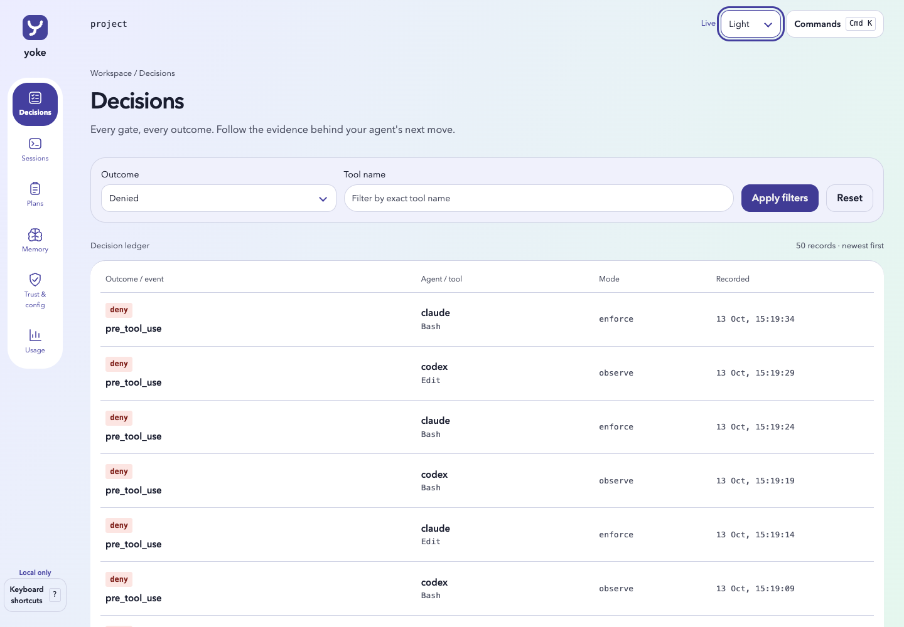

# Yoke

Steer your coding agent with gates you define.

Yoke is a small, fast Rust binary that sits in the hook path of coding agents such as Claude Code and Codex.
On every agent event it runs the checks you configured, records what it decided, and on blocking events it can veto the action with a reason the agent sees.
It is free and open source under MIT OR Apache-2.0.

## Why Yoke

Coding agents follow instructions most of the time.
Yoke is for the rest of the time.

- **Code enforces, prompts inform.** Rules that must hold are checked by a binary, not left to the model's goodwill.
- **Proof, not promises.** A plan is only done when Yoke itself has run its checks on the final code.
- **Nothing silent.** Every allow, deny and error is logged; when Yoke breaks, it says so and fails closed.
- **Safe to try.** New installs start in observe mode: Yoke logs what it would block and blocks nothing.
- **Local and light.** One binary, one SQLite file, no daemon, no telemetry.

## Status

This development version implements the Core, Workflow, Memory, Surfaces, and Presets roadmap features; the package version remains 0.1.0.
Focused CLI checks and browser journeys cover the implemented behavior; final release acceptance is tracked in [the execution record](docs/specs/2026-10-13-core-execution.md).
Local focused checks do not replace the roadmap's full-working-day observe-mode trial, which has not been completed.
The week-long enforce-mode trial, three non-native release builds, and hosted release publication also remain outstanding.

Current code executes only trusted config snapshots.
An older 0.1 skeleton build executes config directly from disk and should only be used in trusted repositories.

## Features

| Feature | What it does | Status |
|---------|--------------|--------|
| Gates | Shell checks on agent events; a failing gate blocks the action on blocking events | Available |
| Layered config | Global `~/.yoke/config.toml` merged with the nearest project `yoke.toml` | Available |
| Decision log | Every hook decision stored with secrets masked, searchable with `yoke log` | Implemented locally, unreleased |
| Observe and enforce modes | Shadow-run beside another harness before letting Yoke block anything | Implemented locally, unreleased |
| Trusted config | Config runs only from snapshots a human approved with `yoke trust` | Implemented locally, unreleased |
| One-command install | `yoke install --agent claude,codex`, reversible with `yoke uninstall` | Implemented locally, unreleased |
| Self-update | `yoke update` with checksum verification and an atomic swap | Implemented locally; release distribution unverified |
| Plans | Plan files in git with human approval and database-owned state | Implemented and focused-tested locally, unreleased |
| Evidence checks | `done` only after Yoke runs the plan's checks on the final working tree | Implemented and focused-tested locally, unreleased |
| Stop guard | Keeps the agent working while a plan is open, with a cap so it cannot loop forever | Implemented and focused-tested locally, unreleased |
| Independent review | A second model reviews the diff and blocking findings fail the plan | Implemented locally; authenticated Codex fixture passed |
| Memory | Facts, remembered notes, an optional session digest and full-text recall | Implemented locally; authenticated digest fixture passed |
| Memory migration | Export and import memories between devices and servers, with project-path mapping and duplicate protection | Implemented and focused-tested locally, unreleased |
| Shared knowledge | Promote a memory into `.yoke/knowledge.md`, then explicitly trust it for context injection | Implemented and focused-tested locally, unreleased |
| Console | A local web console for plans, decisions, memory and usage | Browser journeys passed; release design acceptance tracked separately |
| Statusline | Recorded mode, plan state and alerts in the agent's status bar | Locally tested below 15 ms; reversible Claude installation tested |
| Presets | Ready-made gate packs such as `git-safety`, plus command rewrites | Implemented and focused-tested locally, unreleased |

## Build

Requires a recent stable Rust toolchain.

```bash
cargo build --release
# binary: target/release/yoke
```

## Quick start

```bash
yoke init     # writes a starter yoke.toml in observe mode
yoke trust    # review and approve it from your own interactive terminal
yoke gates    # lists the trusted gates that apply in this directory
```

Try a gate by hand:

```bash
echo '{"tool_name":"Bash","tool_input":{"command":"git push --force"}}' | yoke run-hook pre_tool_use
```

In the default observe mode this prints nothing and records a `would_deny` decision.
Inspect it with `yoke log`.
To enable blocking, set top-level `mode = "enforce"` in `yoke.toml` and review the changed snapshot with `yoke trust` again.
The CLI requires interactive confirmation and rejects detected agent tool processes.
These process checks are safeguards, not an operating-system sandbox.

## Wire it into an agent

Yoke reads the agent's hook payload as JSON on stdin and answers in the agent's documented hook-output format.
Inspect installation changes before applying them:

```bash
yoke install --agent claude,codex --dry-run
yoke install --agent claude,codex
# Later: yoke uninstall
```

Installation preserves unrelated hooks, writes backups and ownership receipts, and is idempotent.
Codex requires you to review new hooks with `/hooks`; installation does not approve them for you.
For Claude Code, `yoke install --agent claude --statusline` also installs the statusline and wraps an existing command while preserving its input and settings.
Uninstall restores the prior statusline when Yoke still owns it and preserves subsequent user changes.
If you register hooks manually, include the agent name in each invocation.
For example, Claude Code settings can include:

```json
{
  "hooks": {
    "PreToolUse": [
      { "matcher": "*", "hooks": [{ "type": "command", "command": "yoke run-hook --agent claude PreToolUse" }] }
    ],
    "Stop": [
      { "hooks": [{ "type": "command", "command": "yoke run-hook --agent claude Stop" }] }
    ]
  }
}
```

## Configuration

Yoke merges trusted snapshots of `~/.yoke/config.toml` (global) and the nearest project `yoke.toml`.
A project gate replaces a global gate with the same name.
Only explicitly supplied project settings override global settings.
Use `yoke trust --global` to approve global config and `yoke config` to inspect effective values, origins, and stale snapshots.
Editing a file does not change the running policy until it is trusted again.
Trusted config and knowledge inputs must be regular, non-symlink files of at most 1 MiB each.
Invalid or inaccessible disk files leave the last approved snapshot in use and appear as stale with a diagnostic.

| Key | Required | Meaning |
|-----|----------|---------|
| `name` | yes | Unique gate name |
| `on` | yes | Event: `pre_tool_use`, `post_tool_use`, `user_prompt_submit`, `stop`, `session_start`, `session_end`, `pre_compact`, `notification` (Claude only) |
| `action` | no | `check` (default), `deny`, or `rewrite` |
| `run` | for `check` | Shell command; a non-zero exit fails the gate |
| `timeout` | no | Command timeout in seconds, default 30 |
| `match_tool` | no | Regex fully matched against the tool name |
| `match_contains` | no | Only run when the payload contains this text |
| `match_pattern` | no | Regex searched in the payload text |
| `message` | no | Reason shown to the agent on failure (defaults to the command's stderr) |
| `shell` | no | Shell used as `<shell> -c <run>` (default `sh`) |
| `rewrite_field` | no | Tool-input field to rewrite, default `command` |
| `rewrite_pattern`, `rewrite_to` | for `rewrite` | Regex and replacement; rewrites apply only on PreToolUse |
| `require_command` | no | Apply a rewrite only while this executable is available on PATH |

Gate commands receive `YOKE_EVENT`, `YOKE_GATE`, `YOKE_TOOL_NAME`, `YOKE_TOOL_INPUT`, `YOKE_SESSION`, `YOKE_CWD`, and `YOKE_PROJECT` in their environment.

## How decisions work

In enforce mode, a failing gate blocks `pre_tool_use`, `user_prompt_submit`, and `stop`.
On every other event, failures are reported but the agent continues.
When nothing fails, Yoke prints nothing and the agent proceeds normally.
Observe mode runs checks and logs decisions without blocking or rewriting tool input.
Only the first matching rewrite applies, after all checks and denials pass.
Codex rewrites require an allow decision that bypasses its ordinary permission prompt for that call, so keep rewrite matchers narrow.
Claude rewrites preserve normal permission evaluation.
Internal errors deny blocking events when enforcement is enabled or the mode cannot be determined.
Set `YOKE_OFF=1` in the hook environment for an explicit bypass.

## Move memory to another environment

Export the current project's memory, or include every project with `--all`:

```bash
yoke memory export ./yoke-memory.json --all
```

Copy the archive to the destination device or server.
The archive is plaintext and can contain sensitive notes; protect it as you would your original memory database.
Existing archive files are preserved unless you explicitly pass `--overwrite`.

Replace the angle-bracket placeholders below with absolute project paths.
Repeat `--map` for every source project in the archive, including projects whose path stays the same:

```bash
yoke memory import ./yoke-memory.json \
  --map '<absolute-source-project>=<absolute-destination-project>' --dry-run
yoke memory import ./yoke-memory.json \
  --map '<absolute-source-project>=<absolute-destination-project>'
```

The dry run reports additions and duplicates without creating a destination database or importing records.
Imports preserve memory identities and fact relationships, skip identical previously imported records, and reject conflicts atomically.
Archives are versioned and bounded to 16 MiB and 20,000 records.
Config trust, plan approvals, agent credentials, and installer state are not transferred.
Imported shared notes remain local until you deliberately share them and approve the resulting knowledge snapshot on the destination.

## Plans and evidence

Create a draft with `yoke plan new <slug>`, then edit its generated Markdown file.
The `+++` TOML header accepts `title`, `review`, and `[[check]]` entries containing `name`, `run`, optional `timeout` seconds, and optional `blocking = false`.
At least one blocking check or required review is necessary.
A human reviews and freezes that header with `yoke plan approve <slug>` from an interactive terminal.

Bind the approved plan to an existing hook session with `yoke plan start <slug> --session <session-id>`.
Run `yoke plan check <slug> --agent claude` or `--agent codex`, naming the building agent so automatic review can select the other agent.
Yoke runs the frozen commands, records their output, and requires an unchanged Git working-tree fingerprint before marking the plan done.
The repository must already have a HEAD commit.
Required reviews need an installed, authenticated reviewer CLI; missing authentication or malformed findings fail the review.

Inspect evidence with `yoke plan status <slug>`.
Use `yoke plan ask '<question>' --slug <slug>` to wait for a human; a human resumes waiting or stalled work with `yoke plan resume <slug>`.
Editing approved checks requires fresh approval, and ordinary hook payloads cannot approve or resume a plan.

## Presets and statusline

`yoke preset list` shows the bundled packs.
`yoke preset add git-safety` appends readable TOML without activating it; inspect the change and run `yoke trust` yourself.
Other packs include `web-redirect`, `token-saver`, and `ui`; their required options are listed by `yoke preset add --help`.
Token-saver requires an explicit executable wrapper, command prefix, and acknowledgment of Codex's rewrite permission behavior.
The UI pack provides commented plan-check templates for your actual browser commands and screenshot paths.

`yoke statusline` reads callback JSON from stdin and reports existing local state without creating or migrating a database.
`yoke statusline --wrap '<existing-command>'` passes the same input to a bounded existing status command and appends its output.
The 15 ms target applies to Yoke's own rendering, excluding the optional wrapper and waiting for stdin to close.
Usage estimates are based on supported transcript fields and a compiled pricing table; unsupported models or missing billing dimensions display unknown cost rather than a guessed amount.
These are API token-price estimates, not subscription invoices.

## Local console

Run `yoke console` from your project to open the loopback-only console, or use `yoke console --no-open` to print its URL without opening a browser.
The URL includes a fresh access token; every page, action, screenshot, and event stream requires it.
Stop the server with Ctrl-C.

Sessions, Plans, Decisions, Memory, Trust & config, and Usage share light/dark themes and keyboard navigation.
Use Cmd+K or Ctrl+K for the command palette and `?` for shortcuts.
Plan approval displays the exact frozen contract before confirmation; memory deletion offers a 30-second Undo.
Trust changes remain an explicit terminal operation.

The console uses the supplied lavender/mint and indigo visual direction, with a redesigned Yoke mark and styled native select controls.


Browser checks cover all six pages in light and dark themes at desktop and 390 px mobile widths, including filters, plan approval/resume, and memory actions.
The 24 checked views had no detected accessibility violations or document overflow; this is not a claim of complete accessibility conformance.

## Roadmap

The full design, with the reasoning behind each decision, is in [docs/specs/2026-10-13-yoke-design.md](docs/specs/2026-10-13-yoke-design.md).

1. **0.2 Core:** decision log, observe and enforce modes, trusted config snapshots, Claude Code and Codex install, self-update.
2. **0.3 Workflow:** plans with human approval, checks Yoke runs itself, stop guard, independent review.
3. **0.4 Memory:** facts, remembered notes, optional session digest, full-text recall, knowledge shared through git, portable import/export between environments.
4. **0.5 Surfaces:** a world-class local web console and a fast statusline.
5. **0.6 Presets:** ready-made gate packs, command rewrites, UI checks.

Version 1.0 is the point where Yoke runs in enforce mode for both agents as the only harness, for a week of real work.

## Changelog maintenance

[CHANGELOG.md](CHANGELOG.md) is generated from reviewed version records in `docs/changes/`.
Update those records when behavior changes, then regenerate and check the output:

```bash
uv run --no-project python scripts/changelog.py
uv run --no-project python scripts/changelog.py --check
```

Do not edit the generated changelog directly.
The current entry is unreleased; a Git push does not publish a binary release.

## Clean-room policy

Yoke is an independent implementation built only from public documentation and public, idea-level concepts.
See [COMPLIANCE.md](COMPLIANCE.md) for the rules every contribution follows.

## License

Licensed under either of [MIT](LICENSE-MIT) or [Apache-2.0](LICENSE-APACHE), at your option.
